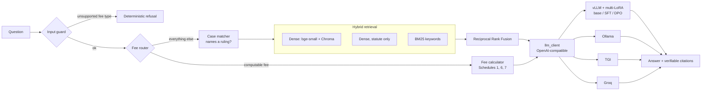

# Advocate Remuneration Assistant

A retrieval-augmented assistant for Kenyan advocates' fees. It answers questions about the Advocates (Remuneration) Order and Kenyan case law on taxation of costs, and computes fees and full bills of costs exactly, using a deterministic calculator rather than the language model's arithmetic. It runs on a hosted API or on a **self-hosted stack** (vLLM, a QLoRA fine-tune and on-policy DPO) behind one env-var switch.

**Live demo:** https://advocate-renumeration-assistant.streamlit.app/  ·  **Portfolio page:** https://mikekeror-rgb.github.io/advocate_renumeration_assistant_v1/  ·  **Research report:** [docs/report.pdf](docs/report.pdf)

**Adapters:** [SFT (epoch 1)](https://huggingface.co/mikekeror/qwen2.5-7b-advocate-sft-lora-ep1)  ·  [DPO](https://huggingface.co/mikekeror/qwen2.5-7b-advocate-dpo-lora)  ·  **Full documentation:** [docs/DOCUMENTATION.md](docs/DOCUMENTATION.md)

The live demo runs a hosted model (gpt-oss-20b on Groq). The self-hosted Qwen2.5-7B stack is what the evaluation below measured.

> Not legal advice. Figures are computed from the Order as revised to 2022 and may not reflect later amendments or a taxing officer's discretion.

## TL;DR

- **Pre-registered test (236 new questions, pipeline frozen and tagged before any run):** removing case-scoped retrieval, full-length context snippets and the fee calculator cost 28.0 points overall (87.7% to 59.7%), while QLoRA SFT and on-policy DPO showed no detectable gain on rulings from unseen cases (-2.9 [-10.1, +4.9] and -2.9 [-12.5, +5.6] points). See [the report](docs/report.pdf).
- Pipeline engineering (retrieval fixes, a deterministic fee calculator, an input guard) drove most of the accuracy gains.
- On the earlier 62-question set, QLoRA SFT eliminated fabricated citations (11 to 0) at parity or better on correctness.
- On-policy DPO (81 pairs mined from the SFT model's own mistakes) reached 92% preference accuracy on held-out pairs and gave the best case attribution, but no measurable correctness gain at n=62.
- The remaining errors are dominated by retrieval misses shared by every model.
- One RTX 4090 serves about 8 concurrent users on this workload, with 2-7% LoRA overhead.

## What it does

- **Answers legal questions with citations.** Every claim cites the exact chunk and case it came from, and the assistant says "Not covered in the provided documents" rather than guessing.
- **Calculates fees exactly.** Questions like "What is the discharge fee for a charge over a Kshs 2,800,000 loan?" are routed to a deterministic calculator (Kshs 15,000), and the model is told to state that figure, not recompute it. Unsupported fee types are refused by an input guard instead of guessed.
- **Builds full bills of costs.** A form produces an itemised High Court bill (Schedule 6), separating professional fees from disbursements, citing the Order's provision for every line, and adding VAT.
- **Shows its own evaluation.** An in-app tab compares base, SFT and DPO results from the evaluation harness.

## How it works



- **Ingestion:** 210 PDFs (the Order plus ~209 Kenya Law rulings) are cleaned, split by section, chunked and tagged with case metadata; the Order's fee tables are extracted separately.
- **Retrieval:** dense search (BAAI/bge-small-en-v1.5 + ChromaDB), a statute-only dense search and BM25 are fused with Reciprocal Rank Fusion. When a question names a ruling, retrieval is scoped to that ruling and its chunks are pinned first. The dense component follows the dense passage retrieval approach of Karpukhin et al. (2020); see the [documentation](docs/DOCUMENTATION.md) for what was and wasn't replicated.
- **Calculation:** a regex router detects computable fee questions and sends them to the fee calculator.
- **Generation:** `llm_client.py` points the same pipeline at Groq, vLLM, Ollama or TGI by changing `LLM_BASE_URL`, `LLM_API_KEY` and `LLM_MODEL`.

## Serving

| Backend | Model | Notes |
|---|---|---|
| vLLM | Qwen2.5-7B-Instruct-AWQ | TTFT 58 ms, ~171 tok/s single stream, short prompt |
| vLLM (multi-LoRA) | Qwen2.5-7B-Instruct + 3 adapters | Base and adapters served side by side from one process |
| Ollama | qwen2.5:7b-instruct-q4_K_M | 8k context, model kept resident |
| TGI | Qwen2.5-7B-Instruct | Separate pod |
| Groq | gpt-oss-20b | Hosted baseline used by the live demo |

## Post-training

**Data:** 550 synthetic examples (300 grounded/ruling, 100 grounded/statute, 60 calculator, 60 refusal, 30 off-scope), generated by gpt-oss-20b run locally. The teacher never writes citations; a script inserts them, so citation format is verifiable. The train/val split is grouped by case, and every eval case, passage, question and amount is excluded from training.

**SFT:** QLoRA (4-bit NF4), LoRA r=16 on all linear layers, 40.4M trainable parameters (0.53%), completion-only loss. 2 epochs on one RTX 4090 in 42.7 minutes (about $0.55). Validation loss was lowest after epoch 1 (0.198 vs 0.206), so epoch 1 was kept.

**DPO:** On-policy. The SFT model answered 448 training prompts; failures (wrong answer or missing source citation) became rejected samples and the gold answer the chosen sample, giving 81 pairs. The reference model is the SFT adapter, with log-probs computed once up front. beta=0.1, LR 2e-5, 2 epochs, NLL regulariser 0.2. Validation preference accuracy rose from 0 to 0.917.

## Evaluation

The harness measures exact numeric correctness, retrieval hits, calculator routing, citation verifiability (does every cited chunk exist in what was retrieved?), whether the answer cites the case it was asked about, and LLM-judged faithfulness. Factual answers are judged against a reference answer.

Three question sets: 24 original questions; 62 questions including 33 held-out ones and three hand-written hard cases; and a 236-question pre-registered set (v3, described below).

| 62-question set | Base | SFT | SFT + DPO |
|---|---|---|---|
| Correctness | 85.5% | 87.1% | 87.1% |
| Fabricated citations | 11 | 0 | 0 |
| Cites the case asked about | 87.2% | 89.7% | 92.3% |
| Faithfulness (1-5) | 4.80 | 4.69 | 4.64 |

On the original 24 questions, base and SFT both score 100% correct, but base fabricates 4 citations and SFT none. At n=62 the correctness differences are within noise; the fabricated-citation drop is the clear effect. Faithfulness dipped slightly for the adapters, which over-compress a few answers. Five questions fail for every model because retrieval never surfaces the right passage.

Evaluation runs surfaced a real bug each time, from silent context truncation (68% of chunks were cut at 1,000 characters) to fabricated citations and a contaminated training example; the [documentation](docs/DOCUMENTATION.md) lists them.

### Pre-registered held-out evaluation (v3)

The 62-question set was used while the pipeline was being tuned, so it flatters the pipeline. v3 was built after the pipeline was frozen (tag `pipeline-frozen-v1`). The hypotheses and analysis plan are in [`eval/PREREG.md`](eval/PREREG.md) and were tagged (`prereg-v3`, final text `prereg-v3.2`) before any system was scored. The set has 236 questions (SHA-256 prefix `95ddd72d65bffeca`): 69 on rulings from 14 cases never used in training or earlier evaluation, 48 on seen rulings, 23 statute, 56 no-answer and 40 fee calculations. Gold fee figures were computed by hand. A question-writing model (qwen/qwen3.8-27b) drafted 276 candidates, and every one was reviewed by hand (194 kept, 42 rewritten, 40 dropped). The training teacher (gpt-oss-20b), the question writer and the judge (gpt-5.4-mini) are three different models.

| System (accuracy %) | All | Unseen rulings | Seen rulings | Fee calc |
|---|---|---|---|---|
| Full pipeline, base model | 87.7 | 78.3 | 79.2 | 100.0 |
| SFT (epoch 1) | 85.2 | 75.4 | 72.9 | 100.0 |
| SFT + DPO | 86.0 | 72.5 | 81.2 | 100.0 |
| Case scoping off | 83.1 | 68.1 | 70.8 | 100.0 |
| Snippets cut to 1,000 chars | 75.8 | 52.2 | 60.4 | 100.0 |
| Fee router and guard off | 77.1 | 79.7 | 85.4 | 20.0 |
| All three off | 59.7 | 42.0 | 54.2 | 22.5 |

Effects with 95% intervals (cluster bootstrap by case, 10,000 resamples):

- Each pipeline component helps: snippets cut -11.9 [-16.9, -6.8] overall; fee router and guard off -10.6 [-16.2, -5.6]; case scoping off -4.7 [-8.8, -0.8]; all three off -28.0 [-34.7, -21.2].
- On unseen rulings, SFT against base is -2.9 [-10.1, +4.9] and DPO against SFT is -2.9 [-12.5, +5.6]. Neither interval excludes zero, so no benefit is detectable at this sample size. That is not evidence that fine-tuning is useless: the unseen rulings come from only 14 cases.
- An identical rerun changed 2 of 236 answers (+0.0 [-1.2, +1.3]).
- Retrieval found the gold evidence for 98.3% of ruling questions, so the losses happen after retrieval.
- A hand re-judging of 30 random answers agreed with the judge on all 30 (13 of them model-judged; see [`eval/judge_handcheck.csv`](eval/judge_handcheck.csv)).
- The fee router and guard misfired on 6 of 236 questions (about 2.5%) by returning a fixed fee message to a question that was not a fee calculation. Tightening their triggers is the clearest next improvement.
- Answer latency per question (pipeline only, 40 mixed questions, one run): 2.10 s median with the full pipeline, 2.03 s without case scoping, 1.83 s with 1,000-character snippets, 2.83 s with the router and guard off.

Full tables with intervals are in [`eval/v3_results.md`](eval/v3_results.md); raw per-question results are `eval/results_ev3_*.csv`. To reproduce, point `LLM_BASE_URL` and `LLM_API_KEY` at a vLLM server serving the base model and both adapters, then:

```bash
./run_v3_eval.sh                                   # refuses to run if the set's hash differs
python eval/analyze_v3.py --out eval/v3_results.md
```

## Load benchmark

RTX 4090, ~3,500-token prompts, 256-token answers. Every request uses a unique prompt: an early run reused prompts and prefix caching made TTFT look like 85 ms at 8 users.

| Users | Model | TTFT p50 / p95 | tok/s per request | Aggregate tok/s |
|---|---|---|---|---|
| 1 | base | 301 ms / 398 ms | 62.6 | 58 |
| 1 | LoRA | 324 ms / 433 ms | 58.4 | 55 |
| 8 | base | 976 ms / 2.4 s | 43.1 | 294 |
| 8 | LoRA | 1.19 s / 1.93 s | 42.8 | 288 |
| 32 | base | 4.8 s / 14.9 s | 22.2 | 437 |
| 32 | LoRA | 5.2 s / 15.8 s | 21.0 | 410 |

LoRA adds 2-7% overhead. Beyond about 8 concurrent users, latency degrades faster than throughput improves.

## Quickstart

```bash
git clone https://github.com/mikekeror-rgb/advocate_renumeration_assistant_v1.git
cd advocate_renumeration_assistant_v1
python -m venv .venv && source .venv/bin/activate
pip install -r requirements.txt
cp .env.example .env                 # add GROQ_API_KEY (free key at console.groq.com)

streamlit run app.py                 # the app
python rag_pipeline_v2.py            # command-line Q&A
python eval/eval.py                  # re-run the evaluation
```

To rebuild the index from new PDFs in `data/raw/`: `python chunk.py && python embed_index.py`.

**Docker (Groq backend):**
```bash
docker compose up --build            # http://localhost:8501
```
Image size: 3.41 GB on disk (806 MB compressed), CPU-only PyTorch, embedding model baked in.

**Self-hosted GPU stack (vLLM + DPO adapter):**
```bash
docker compose --profile gpu up --build   # app on :8502
```
Requires an NVIDIA GPU and the adapter in `./adapters` (or download it from the Hugging Face link above).

**Tests:** `pip install -r requirements-dev.txt && pytest -q`. CI runs lint, unit tests and a Docker build plus compose validation on every push.

## Repository map

| Path | What it holds |
|---|---|
| `app.py` | Streamlit app (Q&A, bill of costs, evaluation tab) |
| `rag_pipeline_v2.py` | Retrieval, prompt building, generation |
| `fee_router.py`, `case_matcher.py` | Calculator routing, input guard, case-scoped retrieval |
| `llm_client.py` | Backend switch |
| `training/` | Data builder, QLoRA SFT, DPO pair mining, DPO trainer |
| `eval/` | Eval harness, question sets, results CSVs, v3 pre-registration (`PREREG.md`) and analysis (`analyze_v3.py`, `v3_results.md`) |
| `docs/` | Research report (`report.pdf`) and the portfolio page (`index.html`, served by GitHub Pages) |
| `run_v3_eval.sh`, `time_pipeline.sh` | v3 evaluation run and per-setting latency timing |
| `scripts/`, `bench.py` | vLLM, Ollama and TGI serving scripts, load benchmark |
| `tests/` | Calculator, matcher, eval-check and benchmark tests |

## Tech stack

Python · pdfplumber · sentence-transformers (bge-small-en-v1.5) · ChromaDB · rank-bm25 · vLLM · Ollama · TGI · PEFT / TRL-style QLoRA and DPO · Groq · Streamlit · Docker · GitHub Actions

## Limitations

- The 24- and 62-question sets are small; differences of a few points are not significant. The 236-question v3 set is larger, but its unseen-ruling stratum covers only 14 cases, so the fine-tuning intervals are wide.
- v3 questions were drafted by a model and checked by one person, and answers are scored by an LLM judge (spot-checked on 30 answers).
- The fee router and guard misfire on about 2.5% of questions.
- Training data is synthetic, written by a 20B teacher and filtered by rules, not reviewed by a lawyer.
- This is a research prototype, not legal advice.

## Related work

- [hybrid-retrieval-eval](https://github.com/mikekeror-rgb/hybrid-retrieval-eval): this project's hybrid retrieval, extracted into a reusable ZenML pipeline and proposed to ZenML's rag-recipes (issue #2).
- DeepEval PR #3375: fix for misleading "invalid JSON" errors from reasoning-model judges, found through this project's own empty-output bug.
- DeepEval issue #3376: proposed catching fabricated `[N]` citations deterministically; implemented by another contributor in PR #3378.

## Author

Mike Keror · [GitHub](https://github.com/mikekeror-rgb)
